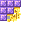

# Tourelle de sorts de base

Tourelle de sorts de base

Basic Spell Turret

Ars Nouveau et extensions

ars_nouveau:basic_spell_turret

!!! success "Présence vérifiée"
    Objet fourni par les fichiers exacts de **Ars Nouveau et extensions**.

## Obtention et fabrication

<strong>Établi — recette ordonnée</strong>ars_nouveau:basic_spell_turret

#########
→

Source exacte : ars_nouveau-1.19.2-3.23.0.jar

<strong>Établi — recette libre</strong>ars_nouveau:rotating_turret_to_basic_spell_turret

<a class="jei-slot" href="../../../catalogue/objets/ars_nouveau/rotating_spell_turret.md" title="Tourelle à sorts ajustable (ars_nouveau:rotating_spell_turret)">?</a>
→

Source exacte : ars_nouveau-1.19.2-3.23.0.jar

## Utilisé dans

- [Tourelle à sorts ajustable](../../../catalogue/objets/ars_nouveau/rotating_spell_turret.md) — <code>ars_nouveau:rotating_spell_turret</code>

## Effets et caractéristiques

!!! info "À confirmer dans la partie"
    Les dégâts, attributs, sorts, affixes, sockets et valeurs NBT dynamiques seront ajoutés après vérification de l'infobulle réelle en jeu.

[Tous les objets de Ars Nouveau et extensions](../../../contenu/ars-nouveau.md)
