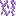

# Lianes lunaires

Lianes lunaires

Lunar Vines

Blue Skies

blue_skies:lunar_vine

!!! success "Présence vérifiée"
    Objet fourni par les fichiers exacts de **Blue Skies**.

## Obtention et fabrication

!!! warning "Pas de recette directe trouvée"
    L'objet peut provenir d'un boss, d'un coffre, d'un échange ou d'une mécanique spéciale visible dans JEI.

## Utilisé dans

- [Pierre taillée lunaire moussue](../../../catalogue/objets/blue_skies/mossy_lunar_stonebrick.md) — <code>blue_skies:mossy_lunar_stonebrick</code>
- [Pierres lunaires moussues](../../../catalogue/objets/blue_skies/mossy_lunar_cobblestone.md) — <code>blue_skies:mossy_lunar_cobblestone</code>

## Effets et caractéristiques

!!! info "À confirmer dans la partie"
    Les dégâts, attributs, sorts, affixes, sockets et valeurs NBT dynamiques seront ajoutés après vérification de l'infobulle réelle en jeu.

[Tous les objets de Blue Skies](../../../contenu/blue-skies.md)
