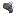

# Bloom Stone Pauldrons

Bloom Stone Pauldrons

L&#x27;Ender&#x27;s Cataclysm

cataclysm:bloom_stone_pauldrons

!!! success "Présence vérifiée"
    Objet fourni par les fichiers exacts de **L'Ender's Cataclysm**.

## Obtention et fabrication

<strong>Établi — recette ordonnée</strong>cataclysm:bloom_stone_pauldrons

→

Source exacte : L_Enders_Cataclysm-2.46-1.19.2.jar

## Utilisé dans

Aucun usage direct trouvé dans les recettes statiques analysées.

## Effets et caractéristiques

!!! info "À confirmer dans la partie"
    Les dégâts, attributs, sorts, affixes, sockets et valeurs NBT dynamiques seront ajoutés après vérification de l'infobulle réelle en jeu.

[Tous les objets de L'Ender's Cataclysm](../../../contenu/cataclysm.md)
