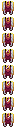

# Ascendant Rouge Leggings

Ascendant Rouge Leggings

Cisco&#x27;s Content

cisco_mod:ascended_hero_rouge_leggings

!!! success "Présence vérifiée"
    Objet fourni par les fichiers exacts de **Cisco's Content**.

## Obtention et fabrication

<strong>Établi — recette ordonnée</strong>cisco_mod:crimson_leggings

→

Source exacte : cisco_mod_9.6.jar

<strong>Établi — recette ordonnée</strong>ciscounbound:crimson_leggings

→

Source exacte : ciscounbound-1.2.jar

## Utilisé dans

Aucun usage direct trouvé dans les recettes statiques analysées.

## Effets et caractéristiques

!!! info "À confirmer dans la partie"
    Les dégâts, attributs, sorts, affixes, sockets et valeurs NBT dynamiques seront ajoutés après vérification de l'infobulle réelle en jeu.

[Tous les objets de Cisco's Content](../../../contenu/cisco-content.md)
