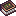

# Guide to Animal Companionship

Guide to Animal Companionship

Enigmatic Legacy et extensions

enigmaticlegacy:animal_guidebook

!!! success "Présence vérifiée"
    Objet fourni par les fichiers exacts de **Enigmatic Legacy et extensions**.

## Obtention et fabrication

<strong>Établi — recette ordonnée</strong>enigmaticlegacy:animal_guidebook

?????
→

Source exacte : EnigmaticLegacy-2.26.5.jar

## Utilisé dans

- [Ode to Living Beings](../../../catalogue/objets/enigmaticaddons/ode_to_living.md) — <code>enigmaticaddons:ode_to_living</code>

## Effets et caractéristiques

!!! info "À confirmer dans la partie"
    Les dégâts, attributs, sorts, affixes, sockets et valeurs NBT dynamiques seront ajoutés après vérification de l'infobulle réelle en jeu.

[Tous les objets de Enigmatic Legacy et extensions](../../../contenu/enigmatic-legacy.md)
