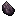
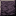

# Dark Rune

Dark Rune

Forbidden &amp; Arcanus

forbidden_arcanus:dark_rune

!!! success "Présence vérifiée"
    Objet fourni par les fichiers exacts de **Forbidden & Arcanus**.

## Obtention et fabrication

<strong>Établi — recette libre</strong>forbidden_arcanus:dark_rune_from_dark_rune_block

→9

Source exacte : forbidden_arcanus-1.19.2-2.1.5.jar

<strong>Établi — recette libre</strong>forbidden_arcanus:dark_rune

→2

Source exacte : forbidden_arcanus-1.19.2-2.1.5.jar

## Utilisé dans

- [Mystical Dagger](../../../catalogue/objets/forbidden_arcanus/mystical_dagger.md) — <code>forbidden_arcanus:mystical_dagger</code>
- [Dark Runic Glass](../../../catalogue/objets/forbidden_arcanus/dark_runic_glass.md) — <code>forbidden_arcanus:dark_runic_glass</code>
- [Dark Rune Block](../../../catalogue/objets/forbidden_arcanus/dark_rune_block.md) — <code>forbidden_arcanus:dark_rune_block</code>

## Effets et caractéristiques

!!! info "À confirmer dans la partie"
    Les dégâts, attributs, sorts, affixes, sockets et valeurs NBT dynamiques seront ajoutés après vérification de l'infobulle réelle en jeu.

[Tous les objets de Forbidden & Arcanus](../../../contenu/forbidden-arcanus.md)
