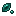

# Draco Arcanus Staff

Draco Arcanus Staff

Forbidden &amp; Arcanus

forbidden_arcanus:draco_arcanus_staff

!!! success "Présence vérifiée"
    Objet fourni par les fichiers exacts de **Forbidden & Arcanus**.

## Obtention et fabrication

<strong>Établi — recette ordonnée</strong>forbidden_arcanus:draco_arcanus_staff

?
→

Source exacte : forbidden_arcanus-1.19.2-2.1.5.jar

## Utilisé dans

- [Draco Arcanus Pickaxe](../../../catalogue/objets/forbidden_arcanus/draco_arcanus_pickaxe.md) — <code>forbidden_arcanus:draco_arcanus_pickaxe</code>
- [Draco Arcanus Axe](../../../catalogue/objets/forbidden_arcanus/draco_arcanus_axe.md) — <code>forbidden_arcanus:draco_arcanus_axe</code>
- [Draco Arcanus Hoe](../../../catalogue/objets/forbidden_arcanus/draco_arcanus_hoe.md) — <code>forbidden_arcanus:draco_arcanus_hoe</code>
- [Draco Arcanus Scepter](../../../catalogue/objets/forbidden_arcanus/draco_arcanus_scepter.md) — <code>forbidden_arcanus:draco_arcanus_scepter</code>
- [Draco Arcanus Shovel](../../../catalogue/objets/forbidden_arcanus/draco_arcanus_shovel.md) — <code>forbidden_arcanus:draco_arcanus_shovel</code>
- [Draco Arcanus Sword](../../../catalogue/objets/forbidden_arcanus/draco_arcanus_sword.md) — <code>forbidden_arcanus:draco_arcanus_sword</code>

## Effets et caractéristiques

!!! info "À confirmer dans la partie"
    Les dégâts, attributs, sorts, affixes, sockets et valeurs NBT dynamiques seront ajoutés après vérification de l'infobulle réelle en jeu.

[Tous les objets de Forbidden & Arcanus](../../../contenu/forbidden-arcanus.md)
