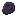
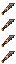

# Dragon Scale

Dragon Scale

Forbidden &amp; Arcanus

forbidden_arcanus:dragon_scale

!!! success "Présence vérifiée"
    Objet fourni par les fichiers exacts de **Forbidden & Arcanus**.

## Obtention et fabrication

<strong>Établi — recette libre</strong>forbidden_arcanus:dragon_scale

?
→3

Source exacte : forbidden_arcanus-1.19.2-2.1.5.jar

## Utilisé dans

- [Draco Arcanus Pickaxe](../../../catalogue/objets/forbidden_arcanus/draco_arcanus_pickaxe.md) — <code>forbidden_arcanus:draco_arcanus_pickaxe</code>
- [Aquatic Dragon Scale](../../../catalogue/objets/forbidden_arcanus/aquatic_dragon_scale.md) — <code>forbidden_arcanus:aquatic_dragon_scale</code>
- [Draco Arcanus Axe](../../../catalogue/objets/forbidden_arcanus/draco_arcanus_axe.md) — <code>forbidden_arcanus:draco_arcanus_axe</code>
- [Draco Arcanus Chestplate](../../../catalogue/objets/forbidden_arcanus/draco_arcanus_chestplate.md) — <code>forbidden_arcanus:draco_arcanus_chestplate</code>
- [Silver Dragon Scale](../../../catalogue/objets/forbidden_arcanus/silver_dragon_scale.md) — <code>forbidden_arcanus:silver_dragon_scale</code>
- [Draco Arcanus Hoe](../../../catalogue/objets/forbidden_arcanus/draco_arcanus_hoe.md) — <code>forbidden_arcanus:draco_arcanus_hoe</code>
- [Draco Arcanus Boots](../../../catalogue/objets/forbidden_arcanus/draco_arcanus_boots.md) — <code>forbidden_arcanus:draco_arcanus_boots</code>
- [Draco Arcanus Shovel](../../../catalogue/objets/forbidden_arcanus/draco_arcanus_shovel.md) — <code>forbidden_arcanus:draco_arcanus_shovel</code>
- [Draco Arcanus Leggings](../../../catalogue/objets/forbidden_arcanus/draco_arcanus_leggings.md) — <code>forbidden_arcanus:draco_arcanus_leggings</code>
- [Golden Dragon Scale](../../../catalogue/objets/forbidden_arcanus/golden_dragon_scale.md) — <code>forbidden_arcanus:golden_dragon_scale</code>
- [Draco Arcanus Helmet](../../../catalogue/objets/forbidden_arcanus/draco_arcanus_helmet.md) — <code>forbidden_arcanus:draco_arcanus_helmet</code>
- [Draco Arcanus Sword](../../../catalogue/objets/forbidden_arcanus/draco_arcanus_sword.md) — <code>forbidden_arcanus:draco_arcanus_sword</code>

## Effets et caractéristiques

!!! info "À confirmer dans la partie"
    Les dégâts, attributs, sorts, affixes, sockets et valeurs NBT dynamiques seront ajoutés après vérification de l'infobulle réelle en jeu.

[Tous les objets de Forbidden & Arcanus](../../../contenu/forbidden-arcanus.md)
