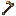

# Reinforced Deorum Hoe

Reinforced Deorum Hoe

Forbidden &amp; Arcanus

forbidden_arcanus:reinforced_deorum_hoe

!!! success "Présence vérifiée"
    Objet fourni par les fichiers exacts de **Forbidden & Arcanus**.

## Obtention et fabrication

!!! warning "Pas de recette directe trouvée"
    L'objet peut provenir d'un boss, d'un coffre, d'un échange ou d'une mécanique spéciale visible dans JEI.

## Utilisé dans

Aucun usage direct trouvé dans les recettes statiques analysées.

## Effets et caractéristiques

!!! info "À confirmer dans la partie"
    Les dégâts, attributs, sorts, affixes, sockets et valeurs NBT dynamiques seront ajoutés après vérification de l'infobulle réelle en jeu.

[Tous les objets de Forbidden & Arcanus](../../../contenu/forbidden-arcanus.md)
