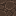

# Soulless Sandstone Wall

Soulless Sandstone Wall

Forbidden &amp; Arcanus

forbidden_arcanus:soulless_sandstone_wall

!!! success "Présence vérifiée"
    Objet fourni par les fichiers exacts de **Forbidden & Arcanus**.

## Obtention et fabrication

<strong>Tailleur de pierre</strong>forbidden_arcanus:stonecutting/soulless_sandstone_wall_from_soulless_sandstone_stonecutting

→

Source exacte : forbidden_arcanus-1.19.2-2.1.5.jar

<strong>Établi — recette ordonnée</strong>forbidden_arcanus:soulless_sandstone_wall

→6

Source exacte : forbidden_arcanus-1.19.2-2.1.5.jar

## Utilisé dans

Aucun usage direct trouvé dans les recettes statiques analysées.

## Effets et caractéristiques

!!! info "À confirmer dans la partie"
    Les dégâts, attributs, sorts, affixes, sockets et valeurs NBT dynamiques seront ajoutés après vérification de l'infobulle réelle en jeu.

[Tous les objets de Forbidden & Arcanus](../../../contenu/forbidden-arcanus.md)
