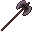
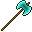

# Netherite Greataxe

Netherite Greataxe

Simply Swords

simplyswords:netherite_greataxe

!!! success "Présence vérifiée"
    Objet fourni par les fichiers exacts de **Simply Swords**.

## Obtention et fabrication

<strong>Table de forge</strong>simplyswords:netherite_greataxe

?
→

Source exacte : simplyswords-forge-1.47.0-1.19.2.jar

## Utilisé dans

- [Runic Greataxe](../../../catalogue/objets/simplyswords/runic_greataxe.md) — <code>simplyswords:runic_greataxe</code>

## Effets et caractéristiques

!!! info "À confirmer dans la partie"
    Les dégâts, attributs, sorts, affixes, sockets et valeurs NBT dynamiques seront ajoutés après vérification de l'infobulle réelle en jeu.

[Tous les objets de Simply Swords](../../../contenu/simply-swords.md)
