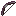
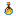

# Golderite Bow

Golderite Bow

Upgraded Netherite

upgradednetherite:gold_upgraded_netherite_bow

!!! success "Présence vérifiée"
    Objet fourni par les fichiers exacts de **Upgraded Netherite**.

## Obtention et fabrication

<strong>Table de forge</strong>upgradednetherite:gold_upgraded_netherite_bow_smithing

?
→

Source exacte : upgradednetherite-1.19.2-5.1.0.9-release.jar

<strong>Table de forge</strong>upgradednetherite:gold_upgraded_netherite_bow_smithing2

→

Source exacte : upgradednetherite-1.19.2-5.1.0.9-release.jar

## Utilisé dans

Aucun usage direct trouvé dans les recettes statiques analysées.

## Effets et caractéristiques

!!! info "À confirmer dans la partie"
    Les dégâts, attributs, sorts, affixes, sockets et valeurs NBT dynamiques seront ajoutés après vérification de l'infobulle réelle en jeu.

[Tous les objets de Upgraded Netherite](../../../contenu/upgraded-netherite.md)
