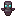

# Netherite Totem of Undying

Netherite Totem of Undying

Upgraded Netherite

upgradednetherite_items:netherite_totem

!!! success "Présence vérifiée"
    Objet fourni par les fichiers exacts de **Upgraded Netherite**.

## Obtention et fabrication

<strong>Table de forge</strong>upgradednetherite_items:netherite_totem_smithing

??
→

Source exacte : upgradednetherite_items-1.19.2-4.1.0.2-release.jar

## Utilisé dans

- [Featherite Totem of Undying](../../../catalogue/objets/upgradednetherite_items/feather_upgraded_netherite_totem.md) — <code>upgradednetherite_items:feather_upgraded_netherite_totem</code>
- [Spiderite Totem of Undying](../../../catalogue/objets/upgradednetherite_items/poison_upgraded_netherite_totem.md) — <code>upgradednetherite_items:poison_upgraded_netherite_totem</code>
- [Golderite Totem of Undying](../../../catalogue/objets/upgradednetherite_items/gold_upgraded_netherite_totem.md) — <code>upgradednetherite_items:gold_upgraded_netherite_totem</code>
- [Enderite Totem of Undying](../../../catalogue/objets/upgradednetherite_items/ender_upgraded_netherite_totem.md) — <code>upgradednetherite_items:ender_upgraded_netherite_totem</code>
- [Witherite Totem of Undying](../../../catalogue/objets/upgradednetherite_items/wither_upgraded_netherite_totem.md) — <code>upgradednetherite_items:wither_upgraded_netherite_totem</code>
- [Echorite Totem of Undying](../../../catalogue/objets/upgradednetherite_items/echo_upgraded_netherite_totem.md) — <code>upgradednetherite_items:echo_upgraded_netherite_totem</code>
- [Blazerite Totem of Undying](../../../catalogue/objets/upgradednetherite_items/fire_upgraded_netherite_totem.md) — <code>upgradednetherite_items:fire_upgraded_netherite_totem</code>
- [Prismarite Totem of Undying](../../../catalogue/objets/upgradednetherite_items/water_upgraded_netherite_totem.md) — <code>upgradednetherite_items:water_upgraded_netherite_totem</code>
- [Phanterite Totem of Undying](../../../catalogue/objets/upgradednetherite_items/phantom_upgraded_netherite_totem.md) — <code>upgradednetherite_items:phantom_upgraded_netherite_totem</code>
- [Corrupterite Totem of Undying](../../../catalogue/objets/upgradednetherite_items/corrupt_upgraded_netherite_totem.md) — <code>upgradednetherite_items:corrupt_upgraded_netherite_totem</code>

## Effets et caractéristiques

!!! info "À confirmer dans la partie"
    Les dégâts, attributs, sorts, affixes, sockets et valeurs NBT dynamiques seront ajoutés après vérification de l'infobulle réelle en jeu.

[Tous les objets de Upgraded Netherite](../../../contenu/upgraded-netherite.md)
