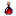
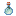
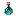
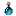
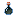
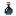
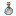

# Ultimerite Essence

Ultimerite Essence

Upgraded Netherite

upgradednetherite_ultimate:ultimate_essence

!!! success "Présence vérifiée"
    Objet fourni par les fichiers exacts de **Upgraded Netherite**.

## Obtention et fabrication

<strong>Établi — recette libre</strong>upgradednetherite_ultimate:ultimate_essence

→

Source exacte : upgradednetherite_ultimate-1.19.2-4.1.0.4-release.jar

## Utilisé dans

- [Ultimerite Ingot](../../../catalogue/objets/upgradednetherite_ultimate/ultimate_upgraded_netherite_ingot.md) — <code>upgradednetherite_ultimate:ultimate_upgraded_netherite_ingot</code>

## Effets et caractéristiques

!!! info "À confirmer dans la partie"
    Les dégâts, attributs, sorts, affixes, sockets et valeurs NBT dynamiques seront ajoutés après vérification de l'infobulle réelle en jeu.

[Tous les objets de Upgraded Netherite](../../../contenu/upgraded-netherite.md)
