# Aquamirae

Labyrinthe océanique, boss, structures, armes et matériaux.

<strong>65</strong> objets indexés
<strong>31</strong> recettes détectées
<a href="https://www.curseforge.com/minecraft/mc-mods/aquamirae">Source documentaire ↗</a>

## Fichiers exacts du pack

- <code>aquamirae-6.API15.jar</code>

!!! warning "La version installée fait foi"
    Les sources externes servent à comprendre le mod. Les recettes affichées ici viennent des fichiers 1.19.2 et des personnalisations Cisco.

## Objets recherchables

<a class="catalog-item" href="../catalogue/objets/aquamirae/abyssal_amethyst.md" title="aquamirae:abyssal_amethyst">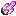Abyssal Amethyst</a>
<a class="catalog-item" href="../catalogue/objets/aquamirae/abyssal_boots.md" title="aquamirae:abyssal_boots">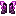Boots of the Blinding Abyss</a>
<a class="catalog-item" href="../catalogue/objets/aquamirae/abyssal_brigantine.md" title="aquamirae:abyssal_brigantine">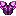Brigantine of the Blinding Abyss</a>
<a class="catalog-item" href="../catalogue/objets/aquamirae/abyssal_heaume.md" title="aquamirae:abyssal_heaume">Heaume of the Blinding Abyss</a>
<a class="catalog-item" href="../catalogue/objets/aquamirae/abyssal_leggings.md" title="aquamirae:abyssal_leggings">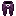Leggings of the Blinding Abyss</a>
<a class="catalog-item" href="../catalogue/objets/aquamirae/abyssal_tiara.md" title="aquamirae:abyssal_tiara">Tiara of the Blinding Abyss</a>
<a class="catalog-item" href="../catalogue/objets/aquamirae/anglerfish_spawn_egg.md" title="aquamirae:anglerfish_spawn_egg">?Anglerfish Spawn Egg</a>
<a class="catalog-item" href="../catalogue/objets/aquamirae/anglers_fang.md" title="aquamirae:anglers_fang">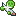Angler&#x27;s Fang</a>
<a class="catalog-item" href="../catalogue/objets/aquamirae/captain_cornelia_spawn_egg.md" title="aquamirae:captain_cornelia_spawn_egg">?Captain Cornelia Spawn Egg</a>
<a class="catalog-item" href="../catalogue/objets/aquamirae/cooked_spinefish.md" title="aquamirae:cooked_spinefish">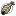Cooked Spinefish</a>
<a class="catalog-item" href="../catalogue/objets/aquamirae/coral_lance.md" title="aquamirae:coral_lance">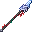Coral Lance</a>
<a class="catalog-item" href="../catalogue/objets/aquamirae/dagger_of_greed.md" title="aquamirae:dagger_of_greed">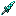Dagger of Greed</a>
<a class="catalog-item" href="../catalogue/objets/aquamirae/dead_sea_scroll.md" title="aquamirae:dead_sea_scroll">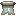Scroll of the Dead Sea</a>
<a class="catalog-item" href="../catalogue/objets/aquamirae/divider.md" title="aquamirae:divider">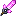Divider</a>
<a class="catalog-item" href="../catalogue/objets/aquamirae/eel_spawn_egg.md" title="aquamirae:eel_spawn_egg">?Eel Spawn Egg</a>
<a class="catalog-item" href="../catalogue/objets/aquamirae/elodea.md" title="aquamirae:elodea">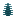Elodea</a>
<a class="catalog-item" href="../catalogue/objets/aquamirae/esca.md" title="aquamirae:esca">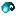Esca</a>
<a class="catalog-item" href="../catalogue/objets/aquamirae/fin.md" title="aquamirae:fin">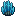Fin</a>
<a class="catalog-item" href="../catalogue/objets/aquamirae/fin_cutter.md" title="aquamirae:fin_cutter">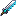Fin Cutter</a>
<a class="catalog-item" href="../catalogue/objets/aquamirae/frozen_chest.md" title="aquamirae:frozen_chest">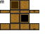Frozen Chest</a>
<a class="catalog-item" href="../catalogue/objets/aquamirae/frozen_key.md" title="aquamirae:frozen_key">Frozen Key</a>
<a class="catalog-item" href="../catalogue/objets/aquamirae/golden_moth_in_a_jar.md" title="aquamirae:golden_moth_in_a_jar">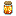Golden Moth in a Jar</a>
<a class="catalog-item" href="../catalogue/objets/aquamirae/golden_moth_spawn_egg.md" title="aquamirae:golden_moth_spawn_egg">?Golden Moth Spawn Egg</a>
<a class="catalog-item" href="../catalogue/objets/aquamirae/luminescent_bubble.md" title="aquamirae:luminescent_bubble">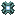Luminescent Bubble</a>
<a class="catalog-item" href="../catalogue/objets/aquamirae/luminescent_lamp.md" title="aquamirae:luminescent_lamp">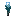Luminescent Lamp</a>
<a class="catalog-item" href="../catalogue/objets/aquamirae/maw_spawn_egg.md" title="aquamirae:maw_spawn_egg">?Maw Spawn Egg</a>
<a class="catalog-item" href="../catalogue/objets/aquamirae/maze_mother_spawn_egg.md" title="aquamirae:maze_mother_spawn_egg">?Mother of the Maze Spawn Egg</a>
<a class="catalog-item" href="../catalogue/objets/aquamirae/maze_rose.md" title="aquamirae:maze_rose">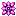Maze Rose</a>
<a class="catalog-item" href="../catalogue/objets/aquamirae/music_disc_forsaken_drownage.md" title="aquamirae:music_disc_forsaken_drownage">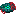Music Disc</a>
<a class="catalog-item" href="../catalogue/objets/aquamirae/music_disc_horizon.md" title="aquamirae:music_disc_horizon">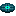Music Disc</a>
<a class="catalog-item" href="../catalogue/objets/aquamirae/oxygelium.md" title="aquamirae:oxygelium">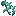Oxygelium</a>
<a class="catalog-item" href="../catalogue/objets/aquamirae/oxygen_tank.md" title="aquamirae:oxygen_tank">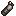Oxygen Tank</a>
<a class="catalog-item" href="../catalogue/objets/aquamirae/painting_anglerfish.md" title="aquamirae:painting_anglerfish">Collectible Painting</a>
<a class="catalog-item" href="../catalogue/objets/aquamirae/painting_aurora.md" title="aquamirae:painting_aurora">Collectible Painting</a>
<a class="catalog-item" href="../catalogue/objets/aquamirae/painting_oxygelium.md" title="aquamirae:painting_oxygelium">Collectible Painting</a>
<a class="catalog-item" href="../catalogue/objets/aquamirae/painting_tortured_soul.md" title="aquamirae:painting_tortured_soul">Collectible Painting</a>
<a class="catalog-item" href="../catalogue/objets/aquamirae/pillagers_patrol_spawn_egg.md" title="aquamirae:pillagers_patrol_spawn_egg">?Pillagers Patrol Spawn Egg</a>
<a class="catalog-item" href="../catalogue/objets/aquamirae/pirate_pouch.md" title="aquamirae:pirate_pouch">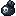Pirate Pouch</a>
<a class="catalog-item" href="../catalogue/objets/aquamirae/poisoned_blade.md" title="aquamirae:poisoned_blade">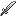Poisoned Blade</a>
<a class="catalog-item" href="../catalogue/objets/aquamirae/poisoned_chakra.md" title="aquamirae:poisoned_chakra">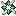Poisoned Chakram</a>
<a class="catalog-item" href="../catalogue/objets/aquamirae/poseidons_breakfast.md" title="aquamirae:poseidons_breakfast">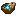Poseidon&#x27;s Breakfast</a>
<a class="catalog-item" href="../catalogue/objets/aquamirae/remnants_saber.md" title="aquamirae:remnants_saber">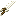Remnant&#x27;s Saber</a>
<a class="catalog-item" href="../catalogue/objets/aquamirae/rune_of_the_storm.md" title="aquamirae:rune_of_the_storm">Rune of the Storm</a>
<a class="catalog-item" href="../catalogue/objets/aquamirae/sea_casserole.md" title="aquamirae:sea_casserole">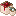Sea Casserole</a>
<a class="catalog-item" href="../catalogue/objets/aquamirae/sea_stew.md" title="aquamirae:sea_stew">Sea Stew</a>
<a class="catalog-item" href="../catalogue/objets/aquamirae/sharp_bones.md" title="aquamirae:sharp_bones">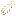Sharp Bones</a>
<a class="catalog-item" href="../catalogue/objets/aquamirae/shell_horn.md" title="aquamirae:shell_horn">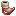Shell Horn</a>
<a class="catalog-item" href="../catalogue/objets/aquamirae/ship_graveyard_echo.md" title="aquamirae:ship_graveyard_echo">Echo of the Ship Graveyard</a>
<a class="catalog-item" href="../catalogue/objets/aquamirae/spinefish.md" title="aquamirae:spinefish">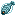Spinefish</a>
<a class="catalog-item" href="../catalogue/objets/aquamirae/spinefish_bucket.md" title="aquamirae:spinefish_bucket">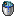Bucket of Spinefish</a>
<a class="catalog-item" href="../catalogue/objets/aquamirae/spinefish_spawn_egg.md" title="aquamirae:spinefish_spawn_egg">?Spinefish Spawn Egg</a>
<a class="catalog-item" href="../catalogue/objets/aquamirae/sweet_lance.md" title="aquamirae:sweet_lance">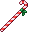Sweet Lance</a>
<a class="catalog-item" href="../catalogue/objets/aquamirae/terrible_boots.md" title="aquamirae:terrible_boots">Terrible Boots</a>
<a class="catalog-item" href="../catalogue/objets/aquamirae/terrible_chestplate.md" title="aquamirae:terrible_chestplate">Terrible Chestplate</a>
<a class="catalog-item" href="../catalogue/objets/aquamirae/terrible_helmet.md" title="aquamirae:terrible_helmet">Terrible Helmet</a>
<a class="catalog-item" href="../catalogue/objets/aquamirae/terrible_leggings.md" title="aquamirae:terrible_leggings">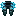Terrible Leggings</a>
<a class="catalog-item" href="../catalogue/objets/aquamirae/terrible_sword.md" title="aquamirae:terrible_sword">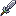Terrible Sword</a>
<a class="catalog-item" href="../catalogue/objets/aquamirae/three_bolt_boots.md" title="aquamirae:three_bolt_boots">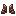Three-Bolt Boots</a>
<a class="catalog-item" href="../catalogue/objets/aquamirae/three_bolt_helmet.md" title="aquamirae:three_bolt_helmet">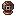Three-Bolt Helmet</a>
<a class="catalog-item" href="../catalogue/objets/aquamirae/three_bolt_leggings.md" title="aquamirae:three_bolt_leggings">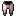Three-Bolt Leggings</a>
<a class="catalog-item" href="../catalogue/objets/aquamirae/three_bolt_suit.md" title="aquamirae:three_bolt_suit">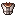Three-Bolt Suit</a>
<a class="catalog-item" href="../catalogue/objets/aquamirae/tortured_soul_spawn_egg.md" title="aquamirae:tortured_soul_spawn_egg">?Tortured Soul Spawn Egg</a>
<a class="catalog-item" href="../catalogue/objets/aquamirae/treasure_pouch.md" title="aquamirae:treasure_pouch">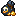Treasure Pouch</a>
<a class="catalog-item" href="../catalogue/objets/aquamirae/whisper_of_the_abyss.md" title="aquamirae:whisper_of_the_abyss">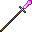Whisper of the Abyss</a>
<a class="catalog-item" href="../catalogue/objets/aquamirae/wisteria_niveis.md" title="aquamirae:wisteria_niveis">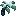Wisteria Niveis</a>

